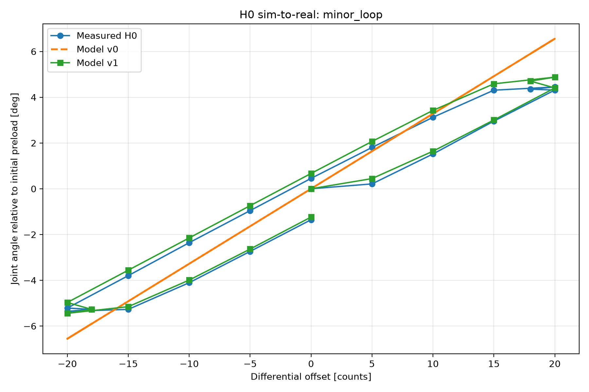
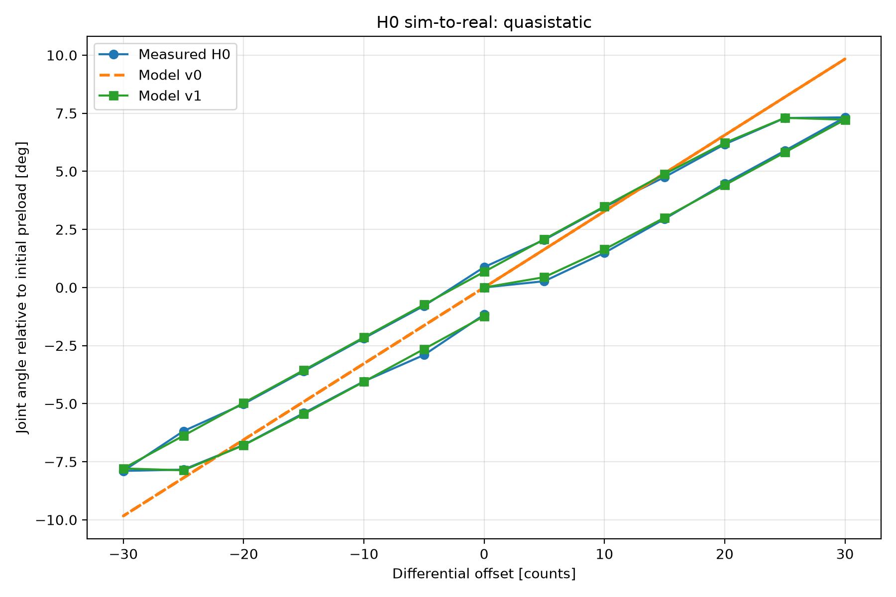
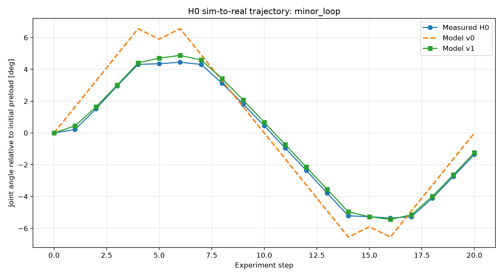

# Antagonistic Joint Sim-to-Real

A simulation-to-real study of a 1-DOF antagonistic tendon-driven
compliant robotic joint.

The project starts from a nominal physics model, realizes the system
in hardware, measures the resulting model mismatch, and develops a
compact stateful model that captures experimentally observed
hysteresis, partial reversals, and relaxation.

The repository also includes the complete mechanical assembly as a
STEP CAD model.

## Key result

The original memoryless model exhibits substantial prediction error
on the realized H0 joint.

| Dataset | Model v0 RMSE | Model v1 RMSE | Improvement |
| --- | ---: | ---: | ---: |
| Quasi-static sweep | 1.364 deg | 0.107 deg | 92.2% |
| Independent minor-loop experiment | 1.256 deg | 0.217 deg | 82.8% |

The minor-loop experiment was performed after Model v1 identification
and specifically tests its continuous internal-memory hypothesis.



## System

H0 is a 1-DOF antagonistic tendon-driven joint with:

- two geared brushed DC motors
- two motor-side incremental encoders
- an AS5600 absolute joint encoder
- antagonistic tendons with extension springs
- STM32 NUCLEO-F446RE control hardware
- BTS7960 motor drivers

Motor position is controlled using a damped encoder-feedback servo,
while host-side experiment runners execute repeatable differential
tendon-displacement sequences.

### Mechanical CAD

The complete H0 mechanical assembly is available as a STEP model:

[`hardware/cad/h0_antagonistic_joint_assembly.stp`](hardware/cad/h0_antagonistic_joint_assembly.stp)

The file contains the assembled hardware geometry used for the realized
H0 platform.

### Hardware demo

A short demonstration of the realized H0 joint executing commanded motion:


Original video file: [move_demo.mp4](media/move_demo.mp4)

## Model progression

### Model v0

The nominal model assumes linear springs and a memoryless mapping from
differential tendon displacement to joint angle.

Its quasi-static prediction is approximately

$$
q = \frac{w_2-w_1}{2r_j}.
$$

The realized joint showed reproducible deviations from this model,
including path dependence and relaxation.

### Model v1

Model v1 introduces a bounded internal hysteresis state

$$
z \in [-1,1]
$$

and uses

$$
q_{\mathrm{eq}} = ax+b+hz
$$

The memory state evolves with differential displacement and is
preserved while the mechanism is stationary. Joint angle subsequently
relaxes toward the memory-dependent equilibrium with an identified
first-order time constant.

This allows Model v1 to represent partial reversals and minor
hysteresis loops that cannot be represented by a binary direction
flag.

## Sim-to-real results

### Quasi-static characterization



Model v1 closely reproduces the major hysteresis loop observed on H0.

### Independent minor-loop validation



The small reversals

```text
+20 -> +18 -> +20
-20 -> -18 -> -20
```

were introduced specifically to test whether hysteresis memory evolves
continuously rather than switching instantaneously with motion direction.

Model v1 predicts the resulting partial-memory behavior substantially
better than Model v0.

## Repository layout

```text
apps/       host-side experiment and validation executables
analysis/   characterization and sim-to-real analysis
firmware/   STM32 H0 firmware
hardware/   mechanical CAD and hardware design artifacts
include/    reusable models, calibration, safety and protocol code
src/        library implementation
tests/      Catch2 regression tests
docs/       experiment/model summaries and canonical figues
```

## Reproducibility

The hardware and model batch runners share canonical experiment
schedules defined in:

```text
include/atj/h0_experiment_schedule.hpp
```

This ensures that the same commanded differential-offset sequence is
used for real H0 experiments and model evaluation.

The final comparison is generated by:

```bash
python analysis/h0_sim2real_batch.py \
    results/h0/quasistatic_sweep_01.csv \
    results/h0/model_quasistatic.csv \
    results/h0/minor_loop_01.csv \
    results/h0/model_minor_loop.csv
```

Raw experimental logs and generated analysis outputs are intentionally
excluded from version control.

See:

```text
docs/h0_sim2real_summary.md
```

for the condensed H0 modeling and validation summary.
